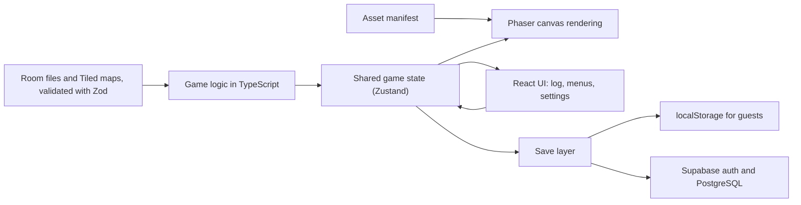

### Initial idea

- Project Overview

    - Short description of the project (elevator pitch)?

        Lantern is a turn-based pixel-art dungeon crawler for the browser, inspired by tabletop RPGs like Dungeons & Dragons. The player explores a dark dungeon where only the area lit by their lantern is visible, fights monsters with dice-based combat, and follows the adventure through a narrated log. The game is built to be fully playable by keyboard and with a screen reader, and players can save an accessibility profile to their account so their settings and progress follow them across devices.

        Browser games are some of the least accessible content on the web, since games rendered on canvas are invisible to assistive technology. Having to reconfigure accessibility settings on every new device is also a real barrier for disabled players. The project explores how a canvas-based game can meet WCAG requirements, how a backend can support a more accessible experience, and how AI agents can be used to extend an accessible codebase.

    - What is the name of the project?

        Lantern

- Tech Stack & Architecture

    - What technologies do you plan to use? (frontend, backend, DB, hosting, third-party services, APIs etc)

        - **Game engine:** Phaser (new technology for me) with TypeScript
        - **Frontend/UI:** React + TypeScript for the adventure log, action menus, inventory, settings and account pages
        - **State management:** Zustand for the shared game state used by both Phaser and React
        - **Build tool:** Vite
        - **Backend & database:** Supabase (new) — PostgreSQL database, authentication and row-level security
        - **Graphics:** CC0 pixel art asset pack, with custom assets created in Aseprite if time allows
        - **Level design:** Tiled map editor (new) for building the dungeon rooms
        - **Data validation:** Zod for validating room data files
        - **Testing:** Vitest for unit tests, Playwright (new) for keyboard-navigation and end-to-end tests
        - **Accessibility testing:** axe-core, Lighthouse, and manual testing with screen readers (NVDA and VoiceOver)
        - **AI tools:** Claude, Claude Code and GitHub Copilot
        - **Hosting:** Vercel or Netlify

        **Architecture:** Phaser renders the dungeon visually on a canvas, while React renders the adventure log and action menus in the DOM. Both read from the same game state, so everything that happens visually is also described in text. The log works as a stylistic feature for all players and as the accessible layer for screen reader users, using ARIA live regions to announce events.

        Rooms are data-driven: a general room engine handles rendering, movement, combat, narration and accessibility, while each room is defined by a Tiled map and a configuration file (enemies, items, exits, descriptions). This keeps accessibility logic in one place and makes it possible for AI agents to build new rooms safely.

        Supabase stores user accounts, save games and each player's accessibility profile (e.g. reduced motion, contrast, text size, log verbosity). Row-level security ensures players can only access their own data. Players can also play as a guest, with saves and settings stored in localStorage, so logging in is never a barrier to playing.

- Moscow

    - Must
        - One small dungeon (3–5 rooms) with grid-based, turn-based exploration
        - Data-driven room format (rooms defined through Tiled maps and configuration files)
        - Lantern mechanic: limited visibility around the player, with narration describing what the light reveals
        - Turn-based combat with dice rolls against at least 3 enemy types
        - Adventure log that describes all game events in text
        - Fully playable with keyboard only, through accessible action menus
        - Screen reader support through ARIA live regions and focus management
        - Accessibility settings: reduced motion, high contrast, text size and log verbosity
        - User accounts with Supabase authentication
        - Save games and accessibility settings synced to the player's account
        - Guest mode with local saves, so an account is optional
        - Accessible login and sign-up that meet WCAG 2.2 Accessible Authentication (works with password managers, no cognitive tests)
        - Pixel art from a CC0 asset pack, loaded through an asset manifest so it can be replaced with custom art later
        - Deployed and playable online
        - Written evaluation of the game against relevant WCAG 2.2 criteria

    - Should
        - Simple inventory with a few usable items (potions, keys)
        - Game speed setting and colorblind-friendly design (information never conveyed by color alone)
        - Sound cues that support, but do not replace, visual and text feedback
        - Option to move a guest save and settings to a new account
        - Passwordless login with magic links
        - Automated accessibility and end-to-end tests (axe-core, Playwright)

    - Could
        - Custom pixel art for player, enemies, tileset and items, created in Aseprite
        - Anonymous, opt-in play data (settings used, run length, input method) to support the evaluation
        - Typed text commands ("go north", "attack goblin") as an alternative input
        - A tavern intro where the player chooses a class, with the story written in ink (inkjs)
        - Animated pixel-art dice rolls
        - Testing sessions with real screen reader users
        - Gamepad support

    - Won't
        - Multiplayer
        - Custom backend server (Supabase is used instead)
        - Real-time action combat
        - Procedurally generated dungeons
        - Mobile touch controls
        - More than one dungeon

- AI

    - How will you use ai in your project? (Tools, methods etc)

        **Tools:** Claude for learning, planning and problem solving, Claude Code as a coding agent, and GitHub Copilot for code completion.

        **Agent workflow: hand-built reference room, agent-built expansion**
        1. **Reference room by hand:** I build the first room completely myself, from start to finish: map, enemies, combat, narration, adventure log, accessibility features, saving and tests. This room becomes the reference implementation for the rest of the game.
        2. **Documented conventions:** Based on the reference room, I write a specification for the agents (e.g. a CLAUDE.md file) describing the room data format, code structure, naming, narration tone and the accessibility requirements every room must meet.
        3. **Agent-built rooms:** Coding agents build the remaining rooms based on my reference room and specification, creating map data, enemy and item configurations and narration text.
        4. **Review and verification:** Every agent-built room is delivered as a pull request that I review. It must pass schema validation, automated tests and accessibility checks, and I test it manually with keyboard and screen reader before it is merged.

        **Evaluation:** In the final report I will compare the agent-built rooms to the reference room: how much they needed to be corrected, whether they met the accessibility requirements, and how much time the workflow saved.

        **Other AI use:**
        - **Learning:** Using Claude to get started with Phaser, Tiled and Supabase faster, with explanations and examples adapted to my project
        - **Security:** Using AI to help review Supabase row-level security policies, verified by testing that users cannot access each other's data
        - **Accessibility:** Asking AI to review components for accessibility issues, but always verifying against the WCAG documentation and real screen reader testing, since AI can be wrong about accessibility
        - **Art:** No AI image generation. The game uses a CC0 asset pack, and any custom art is made by hand in Aseprite.
        - **Documentation:** Keeping an AI log throughout the project (date, tool, what I asked, what I kept or rejected and why), which will be summarized in the final report

### Detailed plan

- MVP

    - Describe the MVP

        The MVP is a complete, deployed playthrough of a small dungeon that can be played from start to finish with keyboard only and with a screen reader. It includes:

        - A dungeon of at least 3 rooms, built on the data-driven room format, where the first room is hand-built and the rest are built by AI agents
        - Grid-based, turn-based movement with the lantern mechanic (limited visibility, narrated surroundings)
        - Turn-based combat with dice rolls against at least 3 enemy types
        - An adventure log that describes all game events, announced to screen readers through ARIA live regions
        - Keyboard-driven action menus with visible focus and logical focus management
        - Accessibility settings: reduced motion, high contrast, text size and log verbosity
        - Guest mode with local saves, and user accounts where saves and settings sync through Supabase
        - Accessible login and sign-up
        - Pixel art from a CC0 asset pack, loaded through a swappable asset manifest

- Definition of Done

    - What criterias needs to be completed or fulfilled to make your project considered finished? (tests, reviewed, deployed, etc)

        **A feature or room is done when:**
        - It is merged to `main` through a pull request that I have reviewed (including all agent-built code)
        - Unit tests, Playwright tests and schema validation pass in CI
        - axe-core reports no serious or critical violations
        - It is fully usable with keyboard only
        - Changes to UI or game events have been tested with a screen reader (NVDA or VoiceOver)
        - It works on the deployed preview

        **The project is done when:**
        - All Must items in the MoSCoW are completed
        - The game is deployed and playable online, with a working guest mode and account sync
        - The written WCAG 2.2 evaluation is complete
        - The evaluation of the agent workflow (reference room vs. agent-built rooms) is complete
        - The README describes the project, setup instructions, tech stack, asset credits and licenses
        - The AI log is complete and summarized
        - The Result section of this file is updated, and the GitHub repo and deploy link are submitted before November 16

- System architecture

    - Describe the system architecture and choices

**Layers and choices:**

- **Game logic (pure TypeScript):** Rules for movement, visibility, combat and dice live in plain TypeScript, separate from Phaser and React. This makes the rules easy to unit test with Vitest and keeps them independent of rendering.
- **Shared game state:** A single Zustand store that both Phaser and React read from and subscribe to. This guarantees that everything shown on the canvas is also available to the accessible DOM layer.
- **Phaser (rendering):** Draws the dungeon, sprites, lantern light and animations on the canvas. It is purely visual: no game rules live here. Animations respect the reduced-motion setting.
- **React (accessible UI):** Renders the adventure log, action menus, inventory, settings and account pages in the DOM. The log uses ARIA live regions to announce events, and menus handle keyboard input and focus management.
- **Data-driven rooms:** A general room engine reads each room from a Tiled map and a JSON configuration file (enemies, items, exits, descriptions). Room files are validated against a Zod schema, both when loaded and in CI. This keeps accessibility logic in one place and lets agents add rooms by writing data rather than code.
- **Asset manifest:** Sprites are referenced by logical names (e.g. `giant-rat`) rather than file paths, so the CC0 asset pack can be replaced with custom Aseprite art by changing the manifest.
- **Save layer (local-first):** Saves and settings are always stored in localStorage. When the player is logged in, they are also synced to Supabase, and the most recently updated version is used. This means guest mode and logged-in mode use the same code, and the game keeps working if the network is down.
- **Supabase:** Handles authentication and stores profiles, save games and accessibility settings in PostgreSQL. Row-level security policies ensure users can only read and write their own data.
- **CI/CD and hosting:** GitHub Actions runs type checks, unit tests, schema validation, Playwright and axe-core tests on every pull request. Vercel deploys a preview for each pull request and production from `main`.

- Sprint Plan

    - Break the project into sprints. For each sprint: what is the goal, and what tasks or Moscow parts belong to it?

        **Sprint 1 (Oct 12–18): Foundation**
        - Goal: A deployed project skeleton where the player can move around the first room with the keyboard.
        - Set up repo, Vite, React, TypeScript, Phaser, ESLint and Prettier
        - Set up GitHub Actions and Vercel deploys
        - Create the Supabase project
        - Choose a CC0 asset pack and set up the asset manifest
        - Build the first room in Tiled and load it in Phaser
        - Shared game state and grid-based keyboard movement
        - Room data format and Zod schema (Must)
        - Start the AI log

        **Sprint 2 (Oct 19–25): Reference room, core gameplay**
        - Goal: The core game loop works in the reference room.
        - Lantern mechanic and narration of surroundings (Must)
        - Turn-based combat with dice and 3 enemy types (Must)
        - Adventure log with ARIA live regions (Must)
        - Keyboard-driven action menus (Must)
        - Unit tests for game logic
        - **Supervision Oct 21:** demo movement, the lantern mechanic and early combat

        **Sprint 3 (Oct 26–Nov 1): Reference room, accessibility complete**
        - Goal: The reference room is finished and fully accessible, and agents start building rooms.
        - Accessibility settings: reduced motion, high contrast, text size, log verbosity (Must)
        - Focus management and screen reader testing of the full room (Must)
        - Guest mode with local saves (Must)
        - Playwright and axe-core tests (Should)
        - Write the agent specification (CLAUDE.md) based on the reference room
        - Agents start building rooms 2–5 at the end of the sprint

        **Sprint 4 (Nov 2–8): Backend and agent-built rooms**
        - Goal: Accounts work, and the full dungeon is playable.
        - Review agent pull requests and log corrections for the evaluation
        - Supabase authentication with accessible login and sign-up (Must)
        - Save games and settings synced to accounts (Must)
        - Row-level security policies and tests that users cannot access each other's data
        - Full playthrough testing with keyboard and screen reader
        - **Supervision Nov 4:** demo the full dungeon and account sync

        **Sprint 5 (Nov 9–15): Shoulds, evaluation and submission**
        - Goal: The project meets the Definition of Done and is submitted.
        - Inventory with potions and keys (Should)
        - Colorblind-friendly design and game speed setting (Should)
        - Written WCAG 2.2 evaluation (Must)
        - Evaluation of the agent workflow
        - README, asset credits, AI log summary and Result section
        - Bug fixes
        - **Submit before November 16**

        **Sprint 6 (Nov 16–22): Polish and presentation**
        - Goal: A polished game and a finished presentation.
        - Remaining Should items: sound cues, moving a guest save to a new account, magic link login
        - Could items if time allows, starting with custom Aseprite art and animated dice rolls
        - Prepare and rehearse the presentation

- Risks & Mitigations

    - Describe risks that could be a hazard to this project
    - For each risk, is there a plan B?

        **Phaser takes longer to learn than expected**
        - Mitigation: Start from Phaser's official React + TypeScript template, keep game rules outside Phaser, and timebox learning to Sprint 1.
        - Plan B: Simplify the visuals (fewer animations, simpler lighting) so the time goes to gameplay and accessibility.

        **Keeping the canvas and the accessible layer in sync is harder than expected**
        - Mitigation: All game events go through the shared game state, so the log and the canvas never have separate sources of truth.
        - Plan B: Reduce visual effects that are hard to describe and make the adventure log the primary way information is presented.

        **Supabase authentication and sync take longer than planned**
        - Mitigation: Guest mode with local saves is built first, so the game works without a backend.
        - Plan B: Ship with accounts and settings sync only, moving save game sync to a later version, and document the limitation.

        **Agent-built rooms are low quality or need heavy correction**
        - Mitigation: A detailed specification, a strict Zod schema and automated tests that catch problems early.
        - Plan B: Build the remaining rooms by hand and reduce the dungeon to 3 rooms. The problems become a finding in the agent evaluation.

        **The asset pack is missing sprites the game needs**
        - Mitigation: Choose a pack based on the game's needs before building rooms, and design enemies around what is available.
        - Plan B: Combine assets from another CC0 pack, or draw the missing sprites in Aseprite.

        **Limited access to screen readers for testing**
        - Mitigation: Use VoiceOver on macOS and NVDA on Windows (or a Windows virtual machine or school computer).
        - Plan B: Test thoroughly with one screen reader and document which were tested.

        **Scope creep**
        - Mitigation: Follow the MoSCoW strictly. Could items are only started in Sprint 6, after submission, and only if all Musts are done.
        - Plan B: Cut Should items in the order listed above, starting from the bottom.

        **Illness or lost time**
        - Mitigation: Musts are prioritized in Sprints 1–4, so Sprint 5 can absorb delays, and Sprint 6 works as a buffer before the presentation.
        - Plan B: Reduce the dungeon size and move remaining Shoulds to "future improvements" in the report.

### Plan changes

Changes to the sprint plan above, with the date and reason. The original plan is kept as it was submitted.

**Oct 19 — Sprint 1 ran over**

- **What happened:** Sprint 1's goal (moving around the first room on the deployed site) wasn't reached by Oct 18. The room loader, store, Tiled room and Phaser rendering were carried over to Sprint 2. Learning Zod and Tiled took longer than planned.
- **Sprint 2 (Oct 19–25):** first finishes Sprint 1, then adds the adventure log as an ARIA live region and the lantern visibility rules (logic and tests only).
- **Moved from Sprint 2 to Sprint 3:** lantern rendering and narration of surroundings, dice, combat with 3 enemy types, keyboard action menus. Action menus fit well with focus management, which was already in Sprint 3.
- **Knock-on effects (to be re-planned at the start of Sprint 3):** guest mode with local saves will probably move to Sprint 4, since it uses the same save layer as account sync. Agents may start building rooms 2–5 early in Sprint 4 instead of at the end of Sprint 3. Sprint 5 is the planned buffer for delays.
- **Planning rule from now on:** sprints are planned on weekdays only. Weekend work is a bonus.

**Oct 28 — Sprint 3 plan**

- **What happened:** Sprints 1 and 2 were only finished by Oct 28, so Sprint 3 has 5 working days left (Wed–Fri plus Sat and Sun), not the usual 5 weekdays, with the weekend counted in.
- **Sprint 3 (Oct 26–Nov 1):** the core game loop (dice, combat with 3 enemy types, action menus with focus management, lantern rendering and narration, accessibility settings). See `docs/sprint-3-plan.md`.
- **Moved to the start of Sprint 4:** the full-room screen reader test, guest mode with local saves, Playwright and axe-core, the agent specification in `CLAUDE.md`, and exits between rooms. **Decided Oct 28:** Sprint 5 is used as the buffer. The screen reader pass and agent spec go first in Sprint 4, accounts follow, and the dungeon stays at 3–5 rooms. If time runs short, inventory and colorblind design (Should) are cut first, as the risks section says.

**Oct 28 — Initiative added to Sprint 3, and what "hand-built" means for the reference room**

- **What happened:** I decided to add initiative rolls to combat in Sprint 3, even though they're not in the MoSCoW. Building the turn model once avoids reshaping the combat code, enemy schema and menu focus later.
- **Effect on the method:** the plan says I build the reference room completely by hand. For initiative I write the tests and Claude Code writes the implementation, which I review. This is logged in `docs/ai-log.md` as code Claude Code wrote. Dice, the attack roll, applying damage and the combat types are my own code. I'll say this in the evaluation, so the comparison with the agent-built rooms is honest about which parts of the reference room were AI-written.
- **Schedule:** Phase L (settings) is still the first thing to slip if time runs short.
